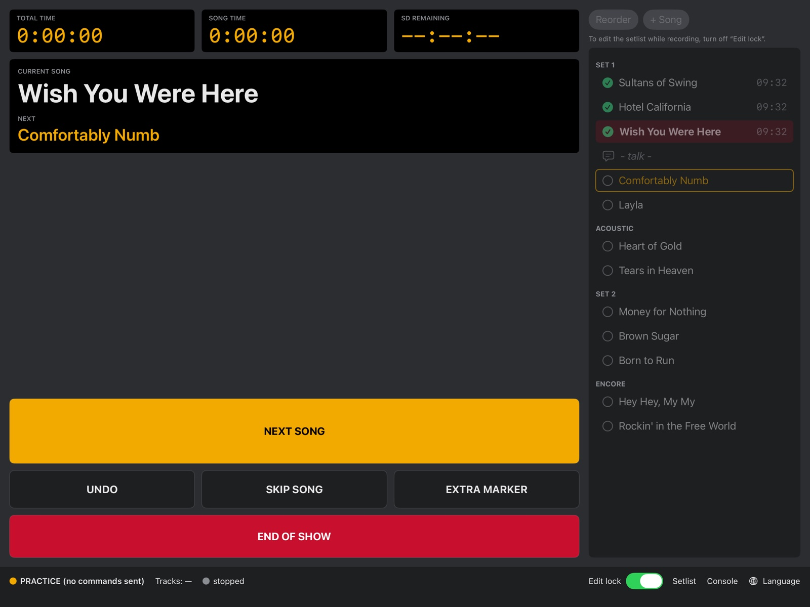

# X-LIVE Concerto

*[Read in English](README.md)*

*L'app durante un concerto (modalità prova, scaletta di esempio).*

App per iPad che comanda dal palco la **scheda di registrazione multitraccia X-LIVE** di un Behringer **X32** / Midas **M32**:
avvia e ferma la registrazione e mette un marker a ogni brano della scaletta, conservando i titoli in un registro.
L'audio resta sulla SD (file WAV). L'app comanda solo la scheda e ricorda a quale brano corrisponde ogni marker,
così il giorno dopo sai esattamente dove inizia ogni canzone.

## Cosa fa
- **Scaletta**: incolli un brano per riga o importi un file .txt / .rtf. Righe come `Set 1:`, `Acustico:`, `Bis:` aprono un nuovo set;
  righe come `- parlato -` o `- talk -` sono momenti parlati (mostrati in grigio e saltati in automatico).
  Una prima riga facoltativa `Locale: Bar Centrale` indica il locale: si vede nell'app e finisce nel registro.
- **START SHOW** avvia la registrazione e mette il primo marker. **NEXT SONG** mette un marker e passa al brano successivo.
- **FINE BRANO (PAUSA)** chiude il brano e apre una pausa (parlato, accordature): lo schermo scrive PAUSA con il tempo di
  pausa e **INIZIA PROSSIMO BRANO** fa partire il brano dopo quando la band è pronta. Le pause sono segnate nel registro,
  così restano fuori dai brani.
- **Indietro**, **Salta brano**, **Fine concerto**. Un tocco su un brano lo rende il prossimo,
  **Riordina** per trascinare i brani, **+ Brano** per aggiungerne uno fuori scaletta.
- Trova la console in rete, oppure scrivi tu l'indirizzo IP.
- Avvisa se la console non risponde (continua a riprovare) o se i marker della console e quelli dell'app non coincidono.
- A fine serata salva un registro in **File → Sul mio iPad → X-LIVE Concerto → Serate** e lo puoi condividere con **AirDrop**.
- **Modalità prova**: per provare tutto senza console (non invia comandi).
- Italiano e inglese: segue la lingua dell'iPad, il tasto con il mappamondo la cambia.

## Cosa serve
- Un Mac con **Xcode** (compilata e provata con Xcode 27.2) e un **iPad** (iPadOS 17 o successivo).
- Basta un Apple ID gratuito, ma in quel caso l'app va reinstallata ogni 7 giorni (con l'account sviluppatore a pagamento no).
- Per registrare davvero: un X32 / M32 con scheda X-LIVE sulla stessa rete locale dell'iPad.

## Compilare e installare
1. Clona il repository e apri `XLiveConcert/XLiveConcert.xcodeproj` in Xcode.
2. Seleziona il progetto → target **XLiveConcert** → **Signing & Capabilities** → scegli il tuo **Team** (il tuo Apple ID).
   Cambia il bundle identifier `com.example.xliveconcerto` con uno tuo (es. `com.tuonome.xliveconcerto`).
3. Collega l'iPad, attiva la **Modalità sviluppatore** (Impostazioni → Privacy e sicurezza), scegli l'iPad come destinazione e premi **Run**.
4. Sull'iPad: Impostazioni → Generali → VPN e gestione dispositivi → autorizza il tuo account sviluppatore, poi apri l'app e
   consenti l'accesso alla **Rete locale**.

## Com'è fatto il progetto
| Cartella | Cosa contiene |
|---|---|
| `XLiveKit/` | Package Swift con la logica: client OSC, ricerca della console, comandi di registrazione, lettura della scaletta, stato della serata, traduzioni. Ha i test (`swift test`) e `xlive-check`, una prova da riga di comando che legge soltanto (`swift run xlive-check 192.168.1.x`). |
| `XLiveApp/` | Interfaccia SwiftUI (iPad; c'è anche una versione Mac, `XLiveMac`, per provarla al volo). |
| `XLiveConcert/` | Il progetto Xcode dell'app iPad. |

## Come parla con la console
OSC su UDP porta 10023. La registrazione si avvia e si ferma scrivendo `/-stat/urec/state` (3 / 0), i marker si aggiungono con
`/-action/addmarker`. La console salva la posizione dei marker nei file della sessione sulla SD, ma non i nomi:
è il registro dell'app che collega il marker N al titolo del brano.

## Problemi noti (ottimi per iniziare a contribuire!)
- Nessuno aperto al momento. Il primo marker in ritardo, il falso avviso "i marker non coincidono" e i tempi dei marker
  mancanti sono stati corretti nella 1.1 (vedi [CHANGELOG.md](CHANGELOG.md)): la console non manda da sola lo stato del
  registratore, quindi ora l'app lo chiede.

## Idee per il futuro
- VU meter degli ingressi sull'iPad (sottoscrizione `/meters`).
- Versione iPhone (layout verticale, vibrazioni, Live Activity).
- "Modalità palco" ad alto contrasto, tasti grandi, "Brano 7 di 18".
- Spazio rimanente sulla SD, salvataggio del registro dopo ogni marker.
- Strumenti per tagliare la registrazione in una cartella per brano e importarla in una DAW. L'autore ha degli script Mac
  per Logic Pro, non ancora inclusi.

## Partecipare
Idee, segnalazioni e prove su altre configurazioni (M32, X32 Compact / Producer, scheda X-UF, altri firmware) sono benvenute:
apri una **Issue** o manda una **Pull Request**. Prima di mandare codice lancia `swift test` in `XLiveKit/`.

## Provata su
X32 Rack, firmware 4.15. Un M32C è stato solo letto, senza registrare.

## Avvertenze
Progetto personale, non affiliato a Behringer o Midas. Usala a tuo rischio e fai sempre una registrazione di prova prima di un live vero.
Rilasciata con [licenza MIT](LICENSE).
