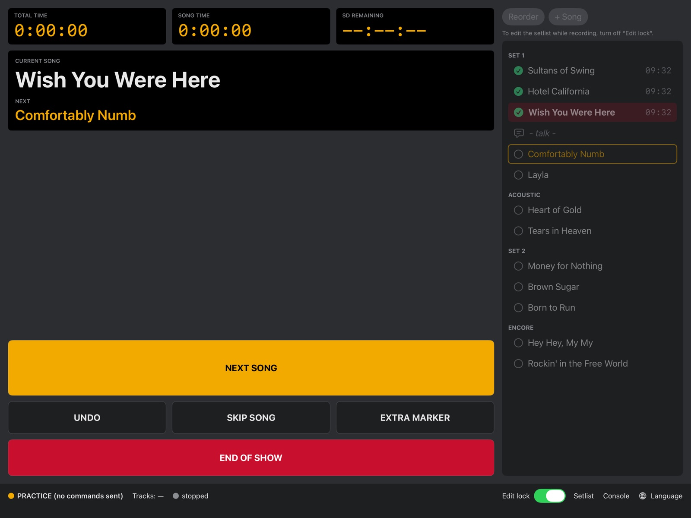

# X-LIVE Concerto

*[Leggi in italiano](README.it.md)*

*The app during a show (practice mode, demo setlist).*

An iPad app that runs the **X-LIVE multitrack recorder card** of a Behringer **X32** / Midas **M32** from the stage:
start and stop recording, and drop a marker at every song of your setlist, with the song names kept in a log.
The audio stays on the SD card (WAV files). The app only controls the card and remembers which marker is which song,
so the morning after you know exactly where every song starts.

## Features
- **Setlist**: paste one song per line or import a .txt / .rtf file. Lines like `Set 1:`, `Acoustic:`, `Encore:` start a new set;
  lines like `- talk -` are treated as speech (shown dimmed and skipped automatically).
  An optional first line `Venue: Blue Note` (or `Locale: …`) names the venue: it is shown in the app and saved in the log.
- **START SHOW** starts recording and places the first marker. **NEXT SONG** places a marker and moves on.
- **END SONG (BREAK)** closes the song and starts a break (talk, tuning): the screen shows BREAK with a break timer and
  **START NEXT SONG** starts the next one when the band is ready. Breaks are marked in the log, so they can be kept out of the songs.
- **UNDO**, **SKIP SONG**, **END OF SHOW**. Tap a song to make it the next one,
  **Reorder** to drag songs, **+ Song** to add one that was not on the list.
- Finds the console on the network, or you type its IP address.
- Warns you if the console stops answering (it keeps retrying) or if the markers on the console and in the app do not match.
- At the end it saves a log in **Files → On My iPad → X-LIVE Concerto → Serate** and offers **SHARE LOG (AirDrop)**.
- **Practice mode**: try everything without a console (no commands are sent).
- Italian and English: follows the iPad language, and the globe button switches it.

## What you need
- A Mac with **Xcode** (built and tested with Xcode 27.2) and an **iPad** (iPadOS 17 or later).
- A free Apple ID is enough. The app then has to be reinstalled every 7 days (a paid developer account removes that limit).
- To record for real: an X32 / M32 with an X-LIVE card on the same local network as the iPad.

## Build and install
1. Clone the repository and open `XLiveConcert/XLiveConcert.xcodeproj` in Xcode.
2. Select the project → target **XLiveConcert** → **Signing & Capabilities** → choose your **Team** (your Apple ID).
   Change the bundle identifier `com.example.xliveconcerto` to something of yours (e.g. `com.yourname.xliveconcerto`).
3. Connect the iPad, enable **Developer Mode** (Settings → Privacy & Security), choose the iPad as destination and press **Run**.
4. On the iPad: Settings → General → VPN & Device Management → trust your developer account, then open the app and
   allow **Local Network** access when asked.

## Project layout
| Folder | What it is |
|---|---|
| `XLiveKit/` | Swift package with the logic: OSC client, console discovery, recorder commands, setlist parsing, show state, translations. Has unit tests (`swift test`) and `xlive-check`, a read-only command-line probe (`swift run xlive-check 192.168.1.x`). |
| `XLiveApp/` | SwiftUI interface (iPad; a Mac version, `XLiveMac`, is there for quick tries). |
| `XLiveConcert/` | The Xcode project for the iPad app. |

## How it talks to the console
OSC over UDP port 10023. Recording is started/stopped by writing `/-stat/urec/state` (3 / 0) and markers are added with
`/-action/addmarker`. The console stores marker positions in the session files on the SD card, but not their names:
the app's log is what links marker N to a song title.

## Known issues (good first contributions!)
- None open right now. The late first marker, the false "markers don't match" banner and the missing marker times were
  fixed in 1.1 (see [CHANGELOG.md](CHANGELOG.md)): the console does not push recorder state, so the app now asks for it.

## Ideas / roadmap
- Input VU meters on the iPad (via `/meters` subscription).
- iPhone version (portrait layout, haptics, Live Activity).
- High-contrast "stage mode", big buttons, "Song 7 of 18".
- Remaining SD card space, saving the log after every marker.
- Tools to cut the recording into one folder per song and import it into a DAW. The author has Mac scripts for Logic Pro
  that are not included yet.

## Contributing
Ideas, bug reports and tests on other setups (M32, X32 Compact / Producer, X-UF card, other firmware) are very welcome:
open an **Issue**, or send a **Pull Request**. Please run `swift test` in `XLiveKit/` before sending code.

## Tested on
X32 Rack, firmware 4.15. An M32C was only read, not recorded on.

## Disclaimer
Not affiliated with Behringer or Midas. Use at your own risk, and always do a test recording before a real show.
Released under the [MIT License](LICENSE).
